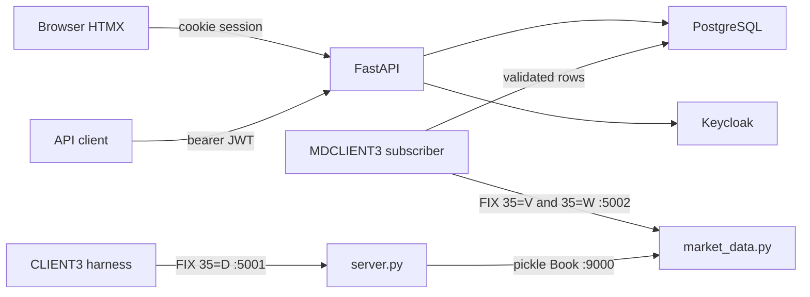

# Secure layer architecture

The legacy exchange stays a FIX 4.2 matching engine. A new read path subscribes to its market-data session, stores a validated book, and serves that book through FastAPI. Browsers use server-rendered HTML. API clients use JSON and a bearer token.

Port 9000 stays a private socket between `server.py` and `market_data.py`. Nothing else connects to it. Compose does not publish 5001 or 5002. The plain `docker run -p` path in `DOCKER.md` still can, for a local experiment.

## Processes

| Process | Image | Role |
| --- | --- | --- |
| `exchange` | existing `pytradesim` | Unchanged gateways. Accepts `CLIENT3` and `MDCLIENT3` |
| `subscriber` | existing `pytradesim` | QuickFIX initiator `MDCLIENT3`. Separate process from the web workers |
| `api` | new Python image | FastAPI, HTMX, JWT, rate limit, audit. No QuickFIX |
| `postgres` | PostgreSQL | Snapshots, trades, alerts, audit, rate policies |
| `keycloak` | Keycloak | Authorization Code + PKCE for the browser, client-credentials tokens for APIs |

Kong, Kafka, Grafana, and a separate surveillance service are out of the first release. Surveillance rules run in the API process, reading the tables the subscriber writes.

The subscriber is built from the existing image so QuickFIX is not compiled twice. It posts or writes only after validation. The API image does not link against QuickFIX.

## Freshness

`35=W` has no exchange timestamp. The subscriber sets:

- `received_at` — when the snapshot was parsed
- `ingest_sequence` — monotonic id assigned by the subscriber
- `exchange_event_time` — null
- `status` — `live`, `stale`, or `uninitialized`

Two different signals:

1. Feed health: FIX logon and time since any message.
2. Symbol freshness: time since that symbol's last snapshot.

A quiet symbol keeps an old `received_at` while the session is healthy, because the gateway sends a snapshot only after a book change (`server.py` sleeps one second between flushes). Lack of a new row does not by itself mean the exchange is down.

After the exchange process restarts, previously stored books are marked `stale` until a new snapshot arrives. A logged-on session with no new snapshot is still stale data. The API does not present those rows as the confirmed live book.

## Authorization

Checked in one policy module, used by `/api/v1` and `/ui`.

| Role | Market data | Alerts | Audit events | Scenario controls |
| --- | --- | --- | --- | --- |
| `market_data_client` | Read | No | No | No |
| `surveillance_analyst` | Read | Read | No | No |
| `security_admin` | Read | Read | Read | Yes |

Browser login is Authorization Code with PKCE. The session cookie is `HttpOnly` and `Secure`, with a `SameSite` value, and state-changing forms also send a CSRF token. API clients send a short-lived JWT. The API checks signature, issuer, audience, expiry, and scope. Tokens are not written to logs or local storage.

## Tables

- `market_snapshots` — latest validated book per symbol, plus receive time, sequence, and status
- `market_observations` — append-only snapshots for the demo history
- `trade_observations` — trade levels as they appeared on `35=W`, with an ingestion id
- `surveillance_rules` — threshold and enabled flag
- `surveillance_alerts` — rule, severity, symbol, observed value, threshold, time
- `audit_events` — identity, action, decision, request id, status, latency
- `rate_limit_policies` — client or role, endpoint category, limit, window
- `feed_status` — one row: FIX logon flag and the time of the last received message

The legacy publisher collapses identical `(price, quantity)` pairs inside one flush. The subscriber does not collapse trades across snapshots. An ingestion id is not an exchange trade id.

The API, not the subscriber, reads each new `market_observations` row. `price_movement` uses the highest trade price on that snapshot, or the best bid when the snapshot has no trade. `spread_widening` is the best ask minus the best bid, and it stays quiet when either side is missing. `volume` sums trade quantities for the symbol inside the rule window. An alert is written when the observed value is above the rule threshold. The row stores the rule, the observed value, the threshold, and the observation time. The same observation is recorded once.

Audit rows are append-only for the API database role. A hash chain can be added later. A hash alone is not tamper-proof storage.

## Rate limits

Postgres counters, updated atomically. If the limiter cannot be read or written, the request is rejected (fail closed).

| Category | Initial policy |
| --- | --- |
| Market-data reads | 60 requests per minute per client |
| Alert queries | 20 requests per minute per client |
| Audit queries | 10 requests per minute per client |
| Scenario execution | 3 requests per minute per admin |

Over the limit: HTTP 429, `Retry-After` when the window end is known, and a body of `error.code = rate_limit_exceeded` plus `request_id`.

## Scenarios

The dashboard cannot move the book by itself. `security_admin` starts a named scenario from `/ui/scenarios`. FastAPI checks the role, the CSRF token, and the rate limit, then stores the scenario name. A separate worker sends the fixed `CLIENT3` orders to port 5001. The read API does not import QuickFIX. The matching engine is unchanged. The subscriber sees the resulting `35=W`. Rules write alerts.

| Scenario | What it does |
| --- | --- |
| Price movement | Orders that move the price past the configured threshold |
| Spread widening | Resting bid and ask far enough apart to trip the spread rule |
| Volume | Several trades whose price or size differ, sent slowly enough that each one is flushed |
| Unauthorized access | A market-data client calls audit and receives 403. The audit row uses that request id |
| Rate-limit abuse | That client exceeds a one-request market-data policy and receives 429. The audit row uses that request id |

The harness request carries only the scenario name: `price_movement`, `spread_widening`, or `volume`. Symbol, side, price, and quantity are fixed in the harness. `ORDER_SYMBOL`, `ORDER_PRICE`, and `ORDER_QTY` are not read. There is no free-form order endpoint.

## Feed limits to keep visible

- Snapshots are change-driven and about one second apart, not tick-by-tick.
- No snapshot is sent at subscribe time. The first `35=W` arrives after the next book change.
- Trade prints on one flush are deduplicated by `(price, quantity)`.
- The live matching book is memory inside the exchange process. Postgres does not restore it.
- Depth requested as 10 is ignored. The gateway sends the full aggregated book, and omits an empty side.

## Out of scope for the first release

Public order, cancel, or replace APIs. Kafka. gRPC. A learned surveillance model. Kong, unless an evaluation explicitly requires a gateway product. Any claim of production market-abuse compliance. Changes to FIFO matching.
