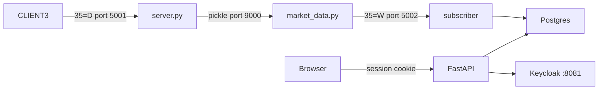

# Run the secure layer

These commands start the FIX exchange, Postgres, Keycloak, and the dashboards. Run them at the repo root, with Docker already running.

## Start

```bash
copy .env.example .env
docker compose up -d --build
docker compose ps -a
```

`.env` holds ports, database passwords, demo passwords, and the public URLs. Compose reads it when the containers start. The file is not copied into an image. If you skip the copy, Compose uses the same defaults that are written in `.env.example`.

When the stack is up:

- `exchange` and `postgres` are healthy.
- `migrate` has exited 0.
- `subscriber` and `scenario-worker` stay unhealthy. Both use the exchange image, and that image's health check looks for listeners on ports 5001 and 5002. Those listeners belong to `exchange`.
- `docker compose logs subscriber` contains `MDCLIENT3 logged on`.

Open http://localhost:8080/ui/login. The host in the address bar has to be `localhost`. Keycloak's redirect URIs are registered for that name, and a callback to `127.0.0.1` is rejected.

The login page shows one card for each demo user. These passwords are the defaults in `.env.example`. The page prints a password when `SHOW_DEMO_CREDENTIALS` is not `0`.

| User | Password | Consoles |
| --- | --- | --- |
| `market` | `market` | Overview, Market |
| `analyst` | `analyst` | Overview, Market, Surveillance |
| `admin` | `admin` | Overview, Market, Surveillance, Security, Scenarios |

Sign out is on every signed-in page. It deletes the app session and sends the browser to Keycloak's end-session endpoint.

One resting bid, so Market has a book to show:

```bash
docker compose --profile order run --rm place-order
```

That is a buy of 40 `BASELINE` at 51. The exchange sends a snapshot about one second after the book changes, so refresh Market after that flush. `MSFT` and `HYG` stay off the page until something changes their books. The subscriber subscribes to `MSFT,HYG,BASELINE,PRICE,SPREAD,VOLUME`.

## How a book reaches the page



`CLIENT3` sends a new order single (`35=D`) to `server.py` on port 5001. Matching stays inside the exchange process. `server.py` pickles the book to `market_data.py` on port 9000, and no other process opens that socket. `market_data.py` sends a market-data snapshot (`35=W`) to the subscriber on port 5002. The subscriber validates the snapshot and writes Postgres. FastAPI and the HTMX pages read those tables. The API image does not link QuickFIX, so the API process has no FIX session.

Keycloak on port 8081 handles the browser login and issues the API tokens. The API listens on port 8080. Compose does not publish 5001, 5002, 9000, or Postgres.

The subscriber is its own container. The scenario worker is a second container on the same image: it takes a queued scenario name and sends the fixed `CLIENT3` orders. Price, spread, and volume rules run in the API process, and so do `api_abuse` and `access_denied`, which count rows in `audit_events`.

## What 35=W contributes

From one snapshot, [secure_api/adapter/normalizer.py](../secure_api/adapter/normalizer.py) keeps the symbol and each entry's type, price, and quantity.

| Entry type | Stored as |
| --- | --- |
| `0` | bid |
| `1` | offer |
| `2` | trade |

A price or quantity that is missing, non-numeric, infinite, or not greater than zero fails validation, and that snapshot is not stored. The symbol has to match `^[A-Z0-9]{1,16}$`.

`35=W` has no exchange timestamp. `exchange_event_time` is null on every stored row. The subscriber sets `received_at` to the time it parsed the message, takes `ingest_sequence` from the database sequence, and writes the row with status `live`. After the exchange process restarts, a stored book stays `stale` until a new snapshot arrives.

The gateway shapes the snapshot before the subscriber sees it:

- A symbol is sent after its book changes, about one second after the previous flush. Logging on does not send the current book.
- A side with no orders is omitted.
- Trades in one flush that share a price and a quantity are collapsed to one print.

Port 9000, execution reports, and the in-memory book stay inside the exchange. Order entry, cancel, and replace stay on the FIX clients in that image. The API has no route that places, cancels, or replaces an order.
